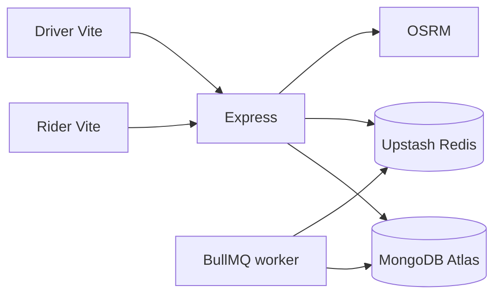

# RideX

Ride-hailing portfolio app. Spec: `docs/BUILD_PROMPT.md`. Architecture: `docs/ARCHITECTURE.md`.

The rider product is a marked road: a vertical route line, MapLibre on the top two-thirds, one primary action in the thumb zone. The driver product is larger type and one decision, because it is used at a red light.

## Local setup

1. Copy `.env.example` to `.env` and fill MongoDB Atlas + Upstash Redis URLs.
2. `npm install`
3. `npm run seed` (optional demo users)
4. `node --env-file=.env server/dist/server.js` after `npm run build -w server`, or `npm run dev`
5. `npm run dev:client`

`GET /health` is liveness. `GET /ready` pings Mongo and Redis.

### Demo logins (after seed)

| Role | Email | Password |
| --- | --- | --- |
| Rider | rider@ridex.dev | password1 |
| Driver | driver@ridex.dev | password1 |
| Admin | admin@ridex.dev | password1 |

## Scripts

- `npm test` — server Jest
- `npm run typecheck` / `npm run lint` / `npm run build`
- `npm run seed` / `npm run bench`

## Demo recording

A 90-second GIF belongs in this README once you record: register/login → estimate → confirm sedan → accept as driver → OTP → complete → cash → milestone receipt. Until that file exists, the receipt page (`/rides/:id/receipt`) is the screenshot that should end the clip.

## Deploy

See `docs/DEPLOYMENT.md`. No Docker.
