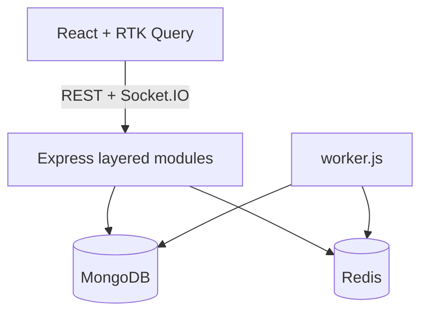
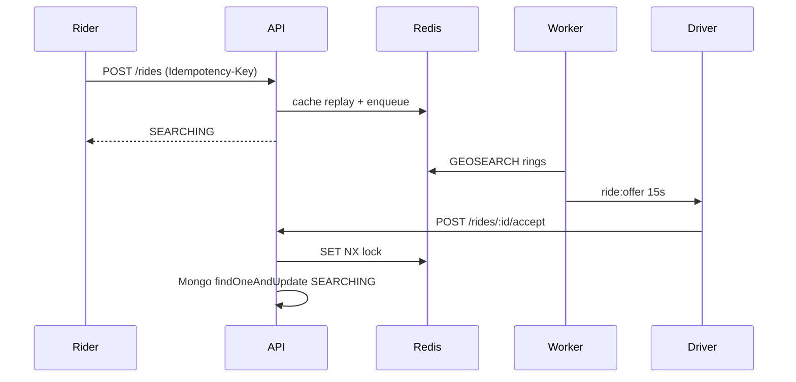
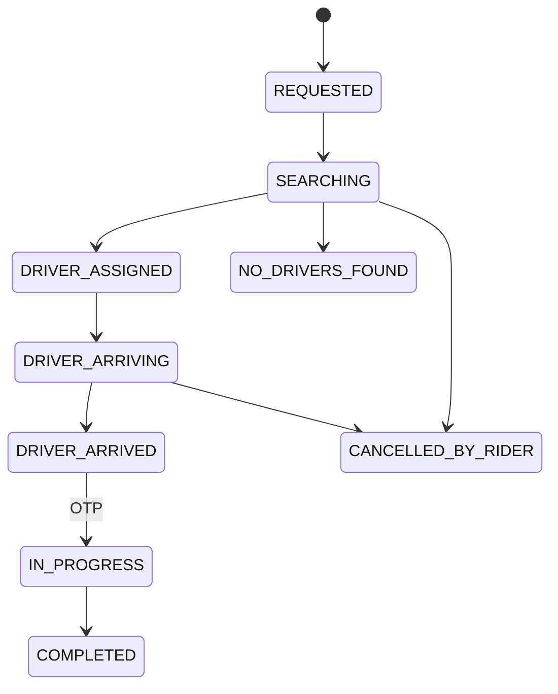

# Architecture

RideX is one Express process plus an optional BullMQ worker. MongoDB holds durable documents. Redis holds sessions of short-lived truth: refresh-family denylist, geo, locks, rate limits, estimate cache, Socket.IO adapter.

## Ride sequence

## Matching

GEOSEARCH 3 km, then 5, then 8. Filter online, verified, idle, vehicle type. Rank 60% distance, 25% rating, 15% acceptance. Sequential offers, three rounds, then `NO_DRIVERS_FOUND`.

## State machine

## Payments

Cash captures in-process. UPI/card create a Razorpay order. Webhooks are idempotent on `event.id`. Driver money is an append-only ledger; balance is `SUM(amount)`.

## AI

`LlmPort` never receives a Mongoose handle. Tools call `RideService` / `PaymentService` with the logged-in user id. OpenAI is optional; `FallbackLlm` keeps the app up after an 8s timeout.
